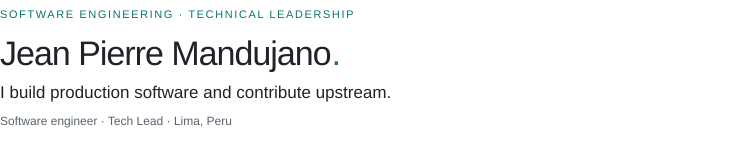
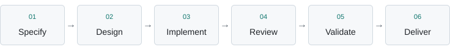

<picture>
  <source media="(prefers-color-scheme: dark)" srcset="assets/profile-header-dark.svg">
  
</picture>

## Where I contribute

<table>
<tr>
<td width="33%" valign="top">
<a href="https://github.com/spring-projects"> <strong>Spring</strong></a> &nbsp; <a href="https://github.com/spring-projects/spring-boot">☆ 81,787</a>
</td>
<td width="33%" valign="top">
<a href="https://github.com/tesseract-ocr"> <strong>Tesseract</strong></a> &nbsp; <a href="https://github.com/tesseract-ocr/tesseract">☆ 77,406</a>
</td>
<td width="33%" valign="top">
<a href="https://github.com/wailsapp"> <strong>Wails</strong></a> &nbsp; <a href="https://github.com/wailsapp/wails">☆ 36,990</a>
</td>
</tr>
<tr>
<td width="33%" valign="top">
<a href="https://github.com/OpenAPITools"> <strong>OpenAPI Tools</strong></a> &nbsp; <a href="https://github.com/OpenAPITools/openapi-generator">☆ 26,850</a>
</td>
<td width="33%" valign="top">
<a href="https://github.com/Automattic"> <strong>Automattic</strong></a> &nbsp; <a href="https://github.com/Automattic/harper">☆ 17,468</a>
</td>
<td width="33%" valign="top">
<a href="https://github.com/kubernetes"> <strong>Kubernetes</strong></a> &nbsp; <a href="https://github.com/kubernetes/website">☆ 5,423</a>
</td>
</tr>
<tr>
<td width="33%" valign="top">
<a href="https://github.com/testcontainers"> <strong>Testcontainers</strong></a> &nbsp; <a href="https://github.com/testcontainers/testcontainers-go">☆ 5,022</a>
</td>
<td width="33%" valign="top">
<a href="https://github.com/open-telemetry"> <strong>OpenTelemetry</strong></a> &nbsp; <a href="https://github.com/open-telemetry/opentelemetry.io">☆ 994</a>
</td>
<td width="33%" valign="top">
<a href="https://github.com/falcosecurity"> <strong>Falco</strong></a> &nbsp; <a href="https://github.com/falcosecurity/falcosidekick">☆ 699</a>
</td>
</tr>
<tr>
<td width="33%" valign="top">
<a href="https://github.com/simpeg"> <strong>SimPEG</strong></a> &nbsp; <a href="https://github.com/simpeg/simpeg">☆ 694</a>
</td>
<td width="33%" valign="top">
<a href="https://github.com/seisbench"> <strong>SeisBench</strong></a> &nbsp; <a href="https://github.com/seisbench/seisbench">☆ 429</a>
</td>
<td width="33%" valign="top">
<a href="https://github.com/fatiando"> <strong>Fatiando a Terra</strong></a> &nbsp; <a href="https://github.com/fatiando/harmonica">☆ 313</a>
</td>
</tr>
<tr>
<td width="33%" valign="top">
<a href="https://github.com/Loop3D"> <strong>Loop3D</strong></a> &nbsp; <a href="https://github.com/Loop3D/LoopStructural">☆ 302</a>
</td>
<td width="33%" valign="top">
<a href="https://github.com/dapr"> <strong>Dapr</strong></a> &nbsp; <a href="https://github.com/dapr/java-sdk">☆ 301</a>
</td>
<td width="33%" valign="top">
<a href="https://github.com/GlacioHack"> <strong>GlacioHack</strong></a> &nbsp; <a href="https://github.com/GlacioHack/xdem">☆ 220</a>
</td>
</tr>
<tr>
<td width="33%" valign="top">
<a href="https://github.com/openrewrite"> <strong>OpenRewrite</strong></a> &nbsp; <a href="https://github.com/openrewrite/rewrite-testing-frameworks">☆ 100</a>
</td>
<td width="33%" valign="top">
<a href="https://github.com/cryostatio"> <strong>Cryostat</strong></a> &nbsp; <a href="https://github.com/cryostatio/cryostat">☆ 58</a>
</td>
</tr>
</table>

More contributions

| Project | Pull requests |
| --- | --- |
| [apache/camel-k](https://github.com/apache/camel-k) | [#6902](https://github.com/apache/camel-k/pull/6902) (open) |
| [apache/lucene](https://github.com/apache/lucene) | [#16643](https://github.com/apache/lucene/pull/16643) (open) |
| [Automattic/harper](https://github.com/Automattic/harper) | [#4425](https://github.com/Automattic/harper/pull/4425) (merged) |
| [cloudevents/sdk-python](https://github.com/cloudevents/sdk-python) | [#302](https://github.com/cloudevents/sdk-python/pull/302) (open) |
| [crafter-research/sunat-cli](https://github.com/crafter-research/sunat-cli) | [#124](https://github.com/crafter-research/sunat-cli/pull/124) (open) |
| [crafter-station/elements](https://github.com/crafter-station/elements) | [#51](https://github.com/crafter-station/elements/pull/51) (open) |
| [crafter-station/trx](https://github.com/crafter-station/trx) | [#43](https://github.com/crafter-station/trx/pull/43) (open) |
| [cryostatio/cryostat](https://github.com/cryostatio/cryostat) | [#1876](https://github.com/cryostatio/cryostat/pull/1876) (merged) |
| [czerwonk/ping_exporter](https://github.com/czerwonk/ping_exporter) | [#166](https://github.com/czerwonk/ping_exporter/pull/166) (merged) |
| [dapr/java-sdk](https://github.com/dapr/java-sdk) | [#1790](https://github.com/dapr/java-sdk/pull/1790) (merged) · [#1796](https://github.com/dapr/java-sdk/pull/1796) (merged) |
| [dapr/python-sdk](https://github.com/dapr/python-sdk) | [#1210](https://github.com/dapr/python-sdk/pull/1210) (merged) |
| [DASDAE/dascore](https://github.com/DASDAE/dascore) | [#927](https://github.com/DASDAE/dascore/pull/927) (closed) My test cases were reused and credited in [#1290](https://github.com/DASDAE/dascore/pull/1290). |
| [equinor/ert](https://github.com/equinor/ert) | [#14798](https://github.com/equinor/ert/pull/14798) (open) |
| [equinor/pyscal](https://github.com/equinor/pyscal) | [#524](https://github.com/equinor/pyscal/pull/524) (open) |
| [equinor/resdata](https://github.com/equinor/resdata) | [#1305](https://github.com/equinor/resdata/pull/1305) (open) |
| [equinor/xtgeo](https://github.com/equinor/xtgeo) | [#1837](https://github.com/equinor/xtgeo/pull/1837) (closed) |
| [falcosecurity/falcosidekick](https://github.com/falcosecurity/falcosidekick) | [#1415](https://github.com/falcosecurity/falcosidekick/pull/1415) (merged) |
| [fatiando/boule](https://github.com/fatiando/boule) | [#294](https://github.com/fatiando/boule/pull/294) (merged) |
| [fatiando/harmonica](https://github.com/fatiando/harmonica) | [#695](https://github.com/fatiando/harmonica/pull/695) (merged) · [#698](https://github.com/fatiando/harmonica/pull/698) (merged) · [#700](https://github.com/fatiando/harmonica/pull/700) (open) |
| [freeCodeCamp/freeCodeCamp](https://github.com/freeCodeCamp/freeCodeCamp) | [#68837](https://github.com/freeCodeCamp/freeCodeCamp/pull/68837) (closed) |
| [gempy-project/gempy](https://github.com/gempy-project/gempy) | [#1110](https://github.com/gempy-project/gempy/pull/1110) (open) |
| [GenericMappingTools/pygmt](https://github.com/GenericMappingTools/pygmt) | [#4965](https://github.com/GenericMappingTools/pygmt/pull/4965) (open) |
| [GlacioHack/geoutils](https://github.com/GlacioHack/geoutils) | [#1003](https://github.com/GlacioHack/geoutils/pull/1003) (closed) |
| [GlacioHack/xdem](https://github.com/GlacioHack/xdem) | [#993](https://github.com/GlacioHack/xdem/pull/993) (merged) |
| [keycloak/keycloak](https://github.com/keycloak/keycloak) | [#52478](https://github.com/keycloak/keycloak/pull/52478) (open) |
| [kubernetes/website](https://github.com/kubernetes/website) | [#57031](https://github.com/kubernetes/website/pull/57031) (merged) |
| [lichess-org/lila](https://github.com/lichess-org/lila) | [#22064](https://github.com/lichess-org/lila/pull/22064) (closed) |
| [Lightning-AI/litgpt](https://github.com/Lightning-AI/litgpt) | [#2330](https://github.com/Lightning-AI/litgpt/pull/2330) (open) |
| [Loop3D/LoopStructural](https://github.com/Loop3D/LoopStructural) | [#293](https://github.com/Loop3D/LoopStructural/pull/293) (merged) · [#297](https://github.com/Loop3D/LoopStructural/pull/297) (open) |
| [moghtech/komodo](https://github.com/moghtech/komodo) | [#1661](https://github.com/moghtech/komodo/pull/1661) (open) · [#1662](https://github.com/moghtech/komodo/pull/1662) (open) |
| [open-telemetry/opentelemetry-python-contrib](https://github.com/open-telemetry/opentelemetry-python-contrib) | [#4840](https://github.com/open-telemetry/opentelemetry-python-contrib/pull/4840) (open) |
| [open-telemetry/opentelemetry.io](https://github.com/open-telemetry/opentelemetry.io) | [#10897](https://github.com/open-telemetry/opentelemetry.io/pull/10897) (merged) · [#11344](https://github.com/open-telemetry/opentelemetry.io/pull/11344) (merged) |
| [OpenAPITools/openapi-generator](https://github.com/OpenAPITools/openapi-generator) | [#25253](https://github.com/OpenAPITools/openapi-generator/pull/25253) (merged) · [#25254](https://github.com/OpenAPITools/openapi-generator/pull/25254) (merged) · [#25073](https://github.com/OpenAPITools/openapi-generator/pull/25073) (open) · [#25074](https://github.com/OpenAPITools/openapi-generator/pull/25074) (open) |
| [openrewrite/rewrite-testing-frameworks](https://github.com/openrewrite/rewrite-testing-frameworks) | [#1117](https://github.com/openrewrite/rewrite-testing-frameworks/pull/1117) (merged) · [#1119](https://github.com/openrewrite/rewrite-testing-frameworks/pull/1119) (open) |
| [OSGeo/PROJ](https://github.com/OSGeo/PROJ) | [#4930](https://github.com/OSGeo/PROJ/pull/4930) (open) · [#4941](https://github.com/OSGeo/PROJ/pull/4941) (open) · [#4942](https://github.com/OSGeo/PROJ/pull/4942) (open) |
| [prometheus/client_java](https://github.com/prometheus/client_java) | [#2316](https://github.com/prometheus/client_java/pull/2316) (closed) The merged fix [#2396](https://github.com/prometheus/client_java/pull/2396) shares my two-part diagnosis. |
| [pyTMD/pyTMD](https://github.com/pyTMD/pyTMD) | [#633](https://github.com/pyTMD/pyTMD/pull/633) (open) |
| [seisbench/seisbench](https://github.com/seisbench/seisbench) | [#435](https://github.com/seisbench/seisbench/pull/435) (merged) |
| [simpeg/simpeg](https://github.com/simpeg/simpeg) | [#1777](https://github.com/simpeg/simpeg/pull/1777) (merged) · [#1803](https://github.com/simpeg/simpeg/pull/1803) (open) · [#1821](https://github.com/simpeg/simpeg/pull/1821) (open) |
| [spring-projects/spring-boot](https://github.com/spring-projects/spring-boot) | [#18489](https://github.com/spring-projects/spring-boot/pull/18489) (integrated manually) |
| [tesseract-ocr/tesseract](https://github.com/tesseract-ocr/tesseract) | [#4650](https://github.com/tesseract-ocr/tesseract/pull/4650) (merged) |
| [testcontainers/testcontainers-go](https://github.com/testcontainers/testcontainers-go) | [#3881](https://github.com/testcontainers/testcontainers-go/pull/3881) (merged) · [#3882](https://github.com/testcontainers/testcontainers-go/pull/3882) (open) |
| [testcontainers/testcontainers-java](https://github.com/testcontainers/testcontainers-java) | [#12072](https://github.com/testcontainers/testcontainers-java/pull/12072) (open) |
| [torchgeo/torchgeo](https://github.com/torchgeo/torchgeo) | [#4111](https://github.com/torchgeo/torchgeo/pull/4111) (open) |
| [Unidata/MetPy](https://github.com/Unidata/MetPy) | [#4095](https://github.com/Unidata/MetPy/pull/4095) (open) · [#4096](https://github.com/Unidata/MetPy/pull/4096) (open) · [#4099](https://github.com/Unidata/MetPy/pull/4099) (open) · [#4200](https://github.com/Unidata/MetPy/pull/4200) (open) |
| [wailsapp/wails](https://github.com/wailsapp/wails) | [#6206](https://github.com/wailsapp/wails/pull/6206) (merged) · [#6205](https://github.com/wailsapp/wails/pull/6205) (closed) |

[All public PRs ↗](https://github.com/search?q=is%3Apr+author%3Amanduinca+is%3Apublic+-user%3Amanduinca+-user%3Adeep-skill&type=pullrequests)

## How I work

**AI-driven SDLC**

I orchestrate AI agents across the software development life cycle: requirements, architecture, implementation, review, testing and delivery. I own the technical decisions and validation.

<picture>
  <source media="(prefers-color-scheme: dark)" srcset="assets/ai-sdlc-dark.svg">
  
</picture>

## What I’m building

I founded [**Deep Skill**](https://deepskill.space) to teach engineers and build software with AI.

<table>
<tr>
<td width="50%" valign="top">

**🎓 Training** 
Science, engineering &amp; AI development

</td>
<td width="50%" valign="top">

**⚙️ AI operations** 
Software delivery, automation &amp; integrations

</td>
</tr>
</table>

## Experience

10+ years · Enterprise &amp; startups

<table>
<tr>
<td width="50%" valign="top">

Enterprise 
**Scotiabank · BCP**

I worked as API Tech Lead and Engineering Manager at Scotiabank’s Digital Factory, and as Tech Lead at BCP.

</td>
<td width="50%" valign="top">

Product &amp; startups 
**Deep Pit Technology**

I co-founded Deep Pit and served as CTO. The company was acquired by STRACON in 2022.

I’ve also worked at Crehana and Fandango.

</td>
</tr>
</table>

Today, I’m also Fractional Tech Lead at Rumbo. [LinkedIn ↗](https://www.linkedin.com/in/jean-pierre-mandujano/)

Geological engineer · Universidad Nacional de Ingeniería
